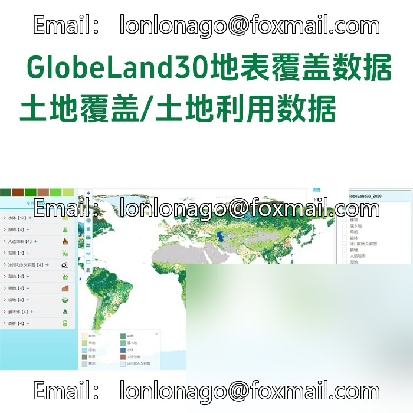
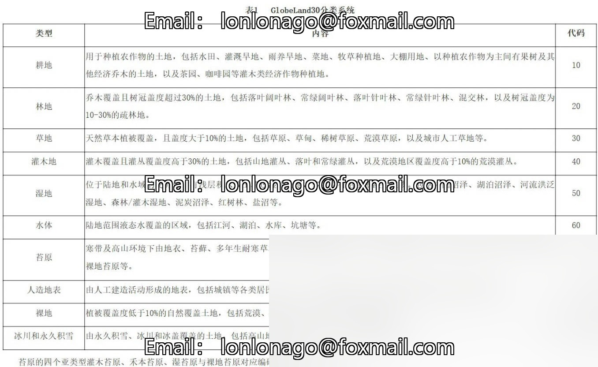

# GlobeLand30 surface coverage data / land coverage / land use data

## Body

GlobeLand30 surface coverage data / land coverage / land use data

Time: 2000, 2010, 2020 (three phases)
Format: tif
Resolution: 30m
Land type: farmland, forest, grassland, shrubland, wetland, water body, artificial surface, bare land, glaciation and permanent snow and ice.
Study research data for personal study and learning

web-based shipment, can be directly photographed and shipped.

The land cover data is provided across three periods—2000, 2010 and 2020—in tif format with a resolution of 30 meters; the categories include farmland, forest, grassland and other land types.

<!-- AI_ENRICHED -->

## Images

## Payment

Here is a pay link on Stripe ( https://buy.stripe.com/3cs8yP7sY87d0vu9AB ). Please contact me lonlonago@foxmail.com after funding $89, and I will send you a complete data files , thank you!

